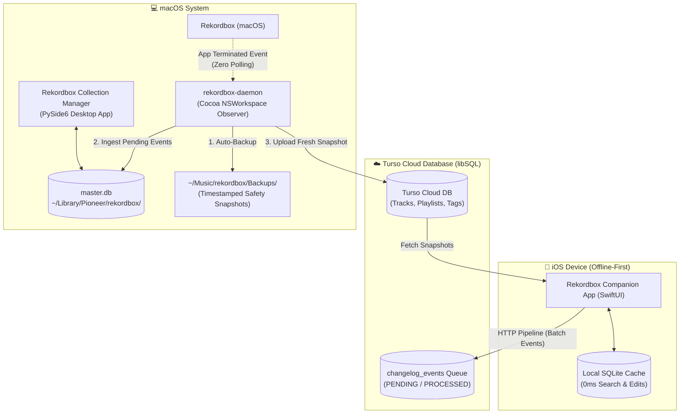

# Rekordbox Collection Manager

A high-performance macOS desktop application, event-driven background sync daemon, native iOS companion app, and collection of standalone utilities for managing, inspecting, and fixing Pioneer / AlphaTheta Rekordbox databases (`master.db` and DeviceSQL `exportLibrary.db`).

---

## Architecture Overview



---

## Table of Contents
- [1. Desktop Application (`rekordbox-manager` / `rekordbox-gui`)](#1-desktop-application-rekordbox-manager--rekordbox-gui)
  - [Views & Features](#views--features)
  - [Launching the Desktop App](#launching-the-desktop-app)
  - [Desktop App Versioning & SemVer CLI](#desktop-app-versioning--semver-cli)
- [2. Rekordbox Companion iOS App](#2-rekordbox-companion-ios-app)
  - [Key Features & Desktop Parity](#key-features--desktop-parity)
  - [Building & Installing on iPhone](#building--installing-on-iphone)
  - [App Versioning & SemVer CLI](#app-versioning--semver-cli)
- [3. Rekordbox Sync Daemon (`rekordbox-daemon`)](#3-rekordbox-sync-daemon-rekordbox-daemon)
  - [Event-Driven Cocoa Observer & Mobile Poll](#event-driven-cocoa-observer--mobile-poll)
  - [Configuration (`.env`)](#configuration-env)
  - [CLI Commands](#cli-commands)
- [4. Replace / Upgrade Audio File (`replace-file`)](#4-replace--upgrade-audio-file-replace-file)
- [5. Rename History (`rename-history`)](#5-rename-history-rename-history)
- [6. Edit Play Count (`edit-play-count`)](#6-edit-play-count-edit-play-count)
- [7. Backup & Restore Operations](#7-backup--restore-operations)
- [Development & Testing](#development--testing)

---

## 1. Desktop Application (`rekordbox-manager` / `rekordbox-gui`)

**Rekordbox Collection Manager** is a native macOS desktop application built with **PySide6 (Qt6)** featuring a Pioneer DJ-inspired dark theme. It combines collection inspection, history curation, play count modification, lossless file upgrades, and cloud sync into a single unified desktop interface.

### Views & Features

#### 🛡️ Live Safety Guard Banner
- Continuously inspects whether the official Rekordbox desktop process is running.
- Safely disables write transactions when Rekordbox is open to protect SQLite journals (`master.db-wal` / `master.db-shm`) from corruption or concurrent lock errors.

#### 🎵 Tracks View & Track Detail View
- **Instant Search & Multi-Filtering**: Search across Title, Artist, Key, Tags, Playlists, or Filename, plus filter by purchase status (`Downloaded`, `Purchased Only`, `Purchasable >=3 plays`), store, play count, audio format, musical key, BPM range, MyTags (`ANY`/`ALL`), and playlists (`ANY`/`ALL`).
- **Multi-Column Sorting**: Sort by Title, Artist, Key, BPM, Duration, Play Count, Bitrate, Audio Format, Purchase Store, Folder, or File Name.
- **Track Detail View**:
  - Inspect full audio tech specs (sample rate, bit depth, bitrate, format, file size, file path), artwork, star rating, BPM, key, and play count.
  - Manage MyTag chips, playlist memberships, and purchase store attribution (`Purchased At`, stored in Rekordbox track comments).
  - View the history log listing every DJ session and venue where the track was played, with click-through jump-to-session navigation.

#### 📁 Playlists View
- Full hierarchical tree navigation of playlist folders, standard playlists, and smart playlists (`attribute = 4`).
- Search tracks within a playlist, view track counts and total duration, create or delete empty playlists/folders, stage inline playlist/tag chip edits, and copy tracklists to clipboard.

#### 🏷️ Tags View
- Visual manager for Pioneer Rekordbox **MyTags**.
- Organized by **Genre** and **Style** category folders, with tag creation, deletion of empty tags, and alphabetical sorting (`A to Z` / `Z to A`) per folder.
- Click any tag to inspect all collection tracks assigned to it.

#### 🕒 History Sessions View
- **Full Hierarchy Loading**: Browses years, months, and individual DJ history playlists without sluggish pagination.
- **Chronological Tree Ordering**: Automatically realigns Rekordbox `djmdHistory.Seq` so months are strictly chronological (January to December) instead of alphabetical, and sessions are sorted from day 01 to day 31.
- **In-Place Editing**: Quick editing of session dates and custom names with `● Staged` visual diff indicators.
- **One-Click Tools**: Auto-extract dates from naming conventions, realign sequence numbers, and execute atomic batch commits.
- **Session Inspector & History Details**:
  - View full tracklists with cue times and duration.
  - **Played With Chips**: Shows transition context (which track was played immediately before or after).
  - **DJ Location Tagging**: Assign or autocomplete venue and gig locations to entire sessions or specific tracks.

#### 🔢 Play Count Manager View
- In-line numeric play count editing with dedicated `[-]` and `[+]` quick stepper buttons on every row.
- Keyboard shortcuts: `+` and `-` keys adjust the highlighted track count.
- Multi-select batch actions (+1, -1, reset to 0, or set custom play count).
- Floor-at-zero safeguard: Play counts can never become negative.

#### 🔄 Replace / Upgrade Audio File View
- Safely upgrade MP3 tracks to AIFF or replace existing AIFF files with another AIFF release (plus a Merge Mode for imported duplicate tracks).
- **100% Data Preservation**: Preserves Rekordbox cue points, hot cues, beatgrids, play counts, original "Date Added" (`StockDate`), playlist memberships, and history session entries.
- Automated audio metadata inspection and side-by-side technical comparison (sample rate, bit depth, bitrate, channels, duration).
- Configurable action for the old audio file: keep, move to macOS Trash, or rename in place to `.bak`.

#### 📊 Analytics View
- Interactive library and live-set analytics dashboard powered by five custom charts: **Crate Health Matrix**, **Camelot Wheel**, **Set Turnover & DNA**, **Survival Decay**, and **Transitions & Combos**.
- Click chart regions or KPI cards to drill down into matching tracks and export purge crates to `.m3u8`, Rekordbox XML, or a new Rekordbox playlist.

#### ℹ️ Collection Info View
- Summary statistics of your Rekordbox library: total track count, total playlists, history sessions, MyTags, active database path, and file size.

### Launching the Desktop App

You can launch the app from the terminal or build a native macOS `.app` bundle:

**Option A: Native macOS App (Dock & Applications)**
```bash
# Build the native macOS .app bundle
./scripts/build_app.sh

# Open the native macOS app
open "dist/Rekordbox Collection Manager.app"
```
> **Tip:** Drag `dist/Rekordbox Collection Manager.app` to your **Applications** folder or Dock to use it like any native macOS app with custom Pioneer-themed app icon and shortcuts.

**Option B: From Terminal**
```bash
# Launch with default master.db
uv run rekordbox-manager
# or
uv run rekordbox-gui

# Launch with custom database (e.g. USB exportLibrary.db)
uv run rekordbox-manager -d /Volumes/USB/PIONEER/exportLibrary.db
```

### Desktop App Versioning & SemVer CLI

The desktop application follows **Semantic Versioning** (`MAJOR.MINOR.PATCH`) stored in [`pyproject.toml`](pyproject.toml) and synchronized with [`uv.lock`](uv.lock).

A dedicated CLI script at [`scripts/desktop_version.py`](scripts/desktop_version.py) manages version bumps, syncs the lockfile, and automates Git commits and tags:

```bash
# Check current desktop version
./scripts/desktop_version.py
# 💻 Rekordbox Collection Manager Desktop:
#    Version (SemVer): 0.9.0

# Bump PATCH: 0.9.0 -> 0.9.1
./scripts/desktop_version.py patch

# Bump MINOR: 0.9.0 -> 0.10.0
./scripts/desktop_version.py minor

# Bump MAJOR: 0.9.0 -> 1.0.0
./scripts/desktop_version.py major

# Set an explicit SemVer version
./scripts/desktop_version.py set 1.0.0

# Preview changes without modifying project files
./scripts/desktop_version.py patch --dry-run

# Bump version, sync uv.lock, auto-commit to git, and create annotated tag 'v0.9.1'
./scripts/desktop_version.py patch --commit --tag
```

---

## 2. Rekordbox Companion iOS App

The **Rekordbox Companion iOS App** (`ios/RekordboxCompanion/`) is a native mobile application built with **SwiftUI (iOS 17+)** that allows you to manage, organize, and curate your Rekordbox library anywhere from your iPhone.

```
ios/RekordboxCompanion/
├── RekordboxCompanion.xcodeproj    # Native Xcode Project
└── RekordboxCompanion/
    ├── Config/
    │   └── TursoConfig.swift        # Cloud DB connection configuration
    ├── Models/
    │   ├── Track.swift              # Track model & rating helpers
    │   ├── Playlist.swift           # Playlist & folder models
    │   ├── Tag.swift                # MyTag models
    │   ├── LiveSession.swift        # Live DJ set session & track models
    │   └── ChangelogEvent.swift     # Mutation events
    ├── Services/
    │   ├── LocalDatabase.swift      # 0ms SQLite3 local storage & mutation queue
    │   ├── TursoSyncService.swift   # Turso libSQL HTTP pipeline client
    │   └── AppState.swift           # App-wide state & sync coordinator
    └── Views/
        ├── MainTabView.swift        # 5-Tab root navigation
        ├── TracksView.swift         # Search, filter, swipe actions, track details
        ├── TrackDetailSheet.swift   # Playlist & MyTag chip assignment editor + track specs
        ├── PlaylistsView.swift      # Folder & playlist browser, playlist creation
        ├── PlaylistDetailView.swift # Track reordering & removal
        ├── LiveSetView.swift        # Mobile DJ live set tracker, venue tagging & history logging
        ├── TagsView.swift           # MyTag categories & tagged tracks
        └── SyncQueueView.swift      # Real-time sync status, queue monitor, manual sync & settings
```

### Key Features & Desktop Parity

- **Excludes Streaming Tracks**: Exactly like the desktop app, tracks from streaming providers (Spotify, Apple Music, Beatport, Beatsource, SoundCloud, Tidal) are completely filtered out from collection queries, playlists, and cloud sync.
- **Offline-First Architecture (0ms Latency)**: Uses an embedded SQLite3 engine on the device (`LocalDatabase.swift`). Searching across tracks, filtering by play status/BPM/key/MyTags, and queuing playlist/MyTag edits responds locally with zero network delay.
- **In-Playlist Drag & Drop Reordering**: Reorder tracks directly within standard playlists using iOS native drag-and-drop (`.onMove`) and remove tracks via trailing swipe actions. New track positions are queued and synced back to `djmdSongPlaylist.TrackNo` in `master.db`.
- **Quick Track Actions & Live Set Logging**: Swipe trailing on tracks in `TracksView` to jump straight to `TrackDetailSheet` or assign a playlist, or track played songs in real time in `LiveSetView` (`LiveSession`).
- **Genre & Style Tag Categorization**: MyTags are strictly categorized into **Genre** and **Style** sections (matching desktop behavior, hiding Components and Situation) with live track counts per tag.
- **Event-Sourced Cloud Sync**: Mobile edits (playlist track additions/removals/reordering, playlist creation, `MyTag` assignments, and completed `Live Set` sessions) are logged into a local mutation queue (`changelog_events`) and synced to Turso cloud via an HTTP pipeline (`TursoSyncService.swift`).
- **5 Tabbed Interface**:
  1. **Tracks**: Collection browser with 6 sort options (Title A–Z, Artist A–Z, BPM ascending/descending, Play Count, Date Added), live search, play-status/BPM/key/MyTag filters, trailing swipe actions (`Details`, `Playlist`), and `TrackDetailSheet` for viewing track specs and editing playlist/MyTag chips.
  2. **Playlists**: Complete folder and playlist hierarchy navigation with live track count badges, drag-and-drop track reordering, and creation of new mobile playlists.
  3. **Live Set**: Real-time mobile DJ set tracker. Log played tracks during a gig, track transitions, tag venues/dates, and sync completed sessions into Rekordbox history.
  4. **MyTags**: Browse your collection grouped strictly by Genre and Style categories with track count badges.
  5. **Sync & Queue**: Cloud connection health check, pending change counter, processed event audit history, dynamic version display, Turso settings sheet, and manual cloud sync trigger.

### Building & Installing on iPhone

1. **Open the project in Xcode**:
   ```bash
   open ios/RekordboxCompanion/RekordboxCompanion.xcodeproj
   ```
2. **Select your Development Team**:
   - In Xcode, select the `RekordboxCompanion` project in the left navigator.
   - Go to **Signing & Capabilities** tab.
   - Under **Signing**, select your personal Apple ID team.
3. **Run on Physical iPhone or Simulator**:
   - Connect your iPhone via USB or select an iOS 17+ Simulator from the scheme dropdown.
   - Press **Cmd + R** (or click the Play button) to build and install.
4. **Cloud Credentials**:
   - The app comes pre-configured with your default Turso database URL and auth token compiled into `TursoConfig.swift`.
   - Inside **Sync & Queue > Settings** (gear icon), you can view or override the Database URL, replace the masked Auth Token (`SecureField`), or tap **Reset to .env Defaults** to restore the `TursoConfig.swift` defaults.

### App Versioning & SemVer CLI

The companion app follows **Semantic Versioning** (`MAJOR.MINOR.PATCH`) mapped directly to Apple's native build settings:
- **Marketing Version (`MARKETING_VERSION` / `CFBundleShortVersionString`)**: SemVer string (`0.1.0`) shown on the App Store, TestFlight, and dynamically rendered in the app footer.
- **Build Number (`CURRENT_PROJECT_VERSION` / `CFBundleVersion`)**: Monotonically increasing build integer (`1, 2, 3...`) required for TestFlight/App Store uploads.

A dedicated CLI script at [`scripts/ios_version.py`](scripts/ios_version.py) manages version bumps atomically across both `Debug` and `Release` build configurations in `project.pbxproj`:

```bash
# Check current version and build number
./scripts/ios_version.py
# 📱 Rekordbox Companion iOS:
#    Marketing Version (SemVer): 0.1.0
#    Build Number (Internal):    1

# Bump PATCH: 0.1.0 -> 0.1.1 (build incremented: 1 -> 2)
./scripts/ios_version.py patch

# Bump MINOR: 0.1.0 -> 0.2.0 (build incremented: 1 -> 2)
./scripts/ios_version.py minor

# Bump MAJOR: 0.1.0 -> 1.0.0 (build incremented: 1 -> 2)
./scripts/ios_version.py major

# Bump only the internal build number (keeps SemVer, increments build)
./scripts/ios_version.py build

# Set an explicit SemVer version
./scripts/ios_version.py set 0.2.0

# Preview changes without modifying project files
./scripts/ios_version.py patch --dry-run

# Bump version, auto-commit to git, and create annotated tag 'ios-v0.1.1'
./scripts/ios_version.py patch --commit --tag
```

> **Why a dedicated CLI instead of Apple's `agvtool`?**
> Apple's built-in `agvtool` (from 2001/2017) has known parsing bugs with modern Xcode projects that use `GENERATE_INFOPLIST_FILE = YES`. It fails searching for `.../../YES` and silently leaves `MARKETING_VERSION` untouched in `project.pbxproj`. The `scripts/ios_version.py` script replaces it with a fast, safe, atomic SemVer manager.

---

## 3. Rekordbox Sync Daemon (`rekordbox-daemon`)

The sync daemon is an event-driven macOS background service that bridges your desktop `master.db` with the **Turso (libSQL)** cloud database. It guarantees that on-the-go mobile edits are safely applied to your collection **without risking SQLite file corruption or file-locking conflicts**.

### Event-Driven Cocoa Observer & Mobile Poll
- Integrates directly with macOS `NSWorkspace` notifications (`NSWorkspaceDidTerminateApplicationNotification` and `NSWorkspaceDidLaunchApplicationNotification`) via `pyobjc-framework-cocoa`.
- **Responsive Cocoa Run Loop**: Dispatches launch/quit notifications natively via `NSRunLoop` in 1-second signal-aware slices and polls Turso for `PENDING` mobile changelog events every `30` seconds while Rekordbox is closed (falling back to polling via `poll_interval` if PyObjC is unavailable).
- **Automated Lifecycle**:
  1. Detects when you quit Rekordbox.
  2. Immediately creates a timestamped safety backup in `~/Music/rekordbox/Backups/`.
  3. Pulls pending change events (`changelog_events`) from Turso and applies them atomically to `master.db`.
  4. Exports an updated snapshot of tracks, playlists, and tags back to Turso.

### Configuration (`.env`)
Create a `.env` file in the root of the repository (automatically ignored by git):
```env
TURSO_DATABASE_URL="https://your-database-name.turso.io"
TURSO_AUTH_TOKEN="your-turso-jwt-token"
```

### CLI Commands

```bash
# Check current daemon & cloud sync status (process state, counts, pending queue):
uv run rekordbox-daemon status

# Run a one-time sync cycle right now:
uv run rekordbox-daemon sync

# Run the daemon in foreground (watches Rekordbox events in real-time):
uv run rekordbox-daemon run

# Install as a persistent macOS background service (auto-starts on login via launchd):
uv run rekordbox-daemon install

# Remove the macOS background service:
uv run rekordbox-daemon uninstall
```

---

## 4. Replace / Upgrade Audio File (`replace-file`)

A specialized utility to replace or upgrade collection tracks (upgrading an MP3 file to AIFF, or replacing an existing AIFF track with another AIFF file) without losing any Rekordbox metadata.

### Highlights
- Transfers and preserves:
  - Cue points & Hot cues (`djmdCue`)
  - Beatgrids & Analysis data
  - Historical DJ play counts and session appearances
  - Original "Date Added" (`StockDate`)
  - Playlist memberships
  - MyTag assignments
- Can be used via the **Replace File** view in the desktop GUI or as a standalone CLI tool.

### CLI Usage
```bash
# Upgrade a specific track by ID with a new lossless file:
uv run replace-file --track-id 12345 --new-file "/path/to/track.aiff" --action keep

# Actions for the old audio file:
#   --action keep     (leave old file intact)
#   --action trash    (move old file to macOS Trash)
#   --action backup   (rename old file in place with a .bak suffix)
```

---

## 5. Rename History (`rename-history`)

Interactively rename and reorder recorded DJ history playlists/sessions in your Rekordbox collection or USB export database.

### Features
- **Chronological Tree Ordering**: Automatically realigns Rekordbox `djmdHistory.Seq` so months are strictly chronological (January to December, month 1 to 12) instead of alphabetical, and history sessions are sorted chronologically from day 01 (top) to day 31 (bottom).
- **Auto-folder Hierarchy**: Ensures target Year and Month folders exist when moving/renaming sessions.
- **Standalone Realign**: Realign all months and sessions anytime via CLI.

### CLI Usage
```bash
# Interactive mode
uv run rename-history

# Realign/sort all months and history sessions without interactive prompt:
uv run rename-history --sort

# Custom database path:
uv run rename-history /Volumes/USB/PIONEER/exportLibrary.db
```

---

## 6. Edit Play Count (`edit-play-count`)

Interactively increment (+1) or decrement (-1) the play count of songs in your Rekordbox collection (`master.db`) or USB export database (`exportLibrary.db`).

### Features
- **Interactive track search**: Type track title keywords to filter matches.
- **Arrow-key selection**: Navigate matching results with arrow keys (↑ / ↓) and press Enter.
- **Safety check**: Automatically checks whether Rekordbox is running before database modifications.
- **Floor at zero**: Decrementing will never cause play count to go negative.

### CLI Usage
```bash
# Interactive mode:
uv run edit-play-count

# Search directly for a track title:
uv run edit-play-count "Titanium"

# Automatically increment (+1) on selection:
uv run edit-play-count "Titanium" --inc

# Automatically decrement (-1) on selection:
uv run edit-play-count "Titanium" --dec

# With custom database path:
uv run edit-play-count -d /Volumes/USB/PIONEER/exportLibrary.db
```

---

## 7. Backup & Restore Operations

Safeguard and restore your entire macOS Rekordbox collection (`master.db`, playlists, sync caches, and configs) both inside the GUI application and via standalone CLI scripts:

### Dedicated Storage Location
Backups are organized in `~/Music/rekordbox/Backups/` (alongside Rekordbox's `Recording/` and `Sampler/` folders), keeping your Desktop clean and preventing unwanted iCloud Drive auto-sync uploads.

### In the Desktop App
- **`📦 Quick Backup` Header Button**: 1-click snapshot saved straight to `~/Music/rekordbox/Backups/` with prompt to reveal in Finder.
- **`Database` Menu**:
  - `📁 Switch Database...` (`Cmd+O`)
  - `🔄 Reload Database` (`Cmd+R`)
  - `📦 Create Backup...` (`Cmd+Shift+B`)
  - `📥 Restore from Backup...`: Opens the guided **Restore Dialog** listing all snapshots with creation timestamps, sizes, Rekordbox process safety guard, and automatic collection reloading.
  - `📂 Reveal Database in Finder` & `🗂️ Reveal Backups in Finder`

### Standalone Shell Scripts (`scripts/`)
```bash
# Create timestamped collection snapshot:
./scripts/backup_rekordbox_mac.sh

# Guided interactive restore (lists backups, prompts for choice):
./scripts/restore_rekordbox_mac.sh

# Restore specific backup directly:
./scripts/restore_rekordbox_mac.sh ~/Music/rekordbox/Backups/rekordbox_mac_backup_20260920_002628

# Non-interactive mode (auto-confirms):
./scripts/restore_rekordbox_mac.sh -y ~/Music/rekordbox/Backups/rekordbox_mac_backup_20260920_002628
```

---

## Development & Testing

### Running Tests
```bash
# Run full pytest test suite (420+ tests)
uv run pytest
```

### Adding New Tools
Each CLI tool is self-contained in a single file under `src/rekordbox_collection_manager/`:
1. **Create the tool file**: `src/rekordbox_collection_manager/<your_tool>.py` with a `main()` function.
2. **Register the tool by name**: In `pyproject.toml`, add an entry under `[project.scripts]`:
   ```toml
   [project.scripts]
   your-tool = "rekordbox_collection_manager.your_tool:main"
   ```
