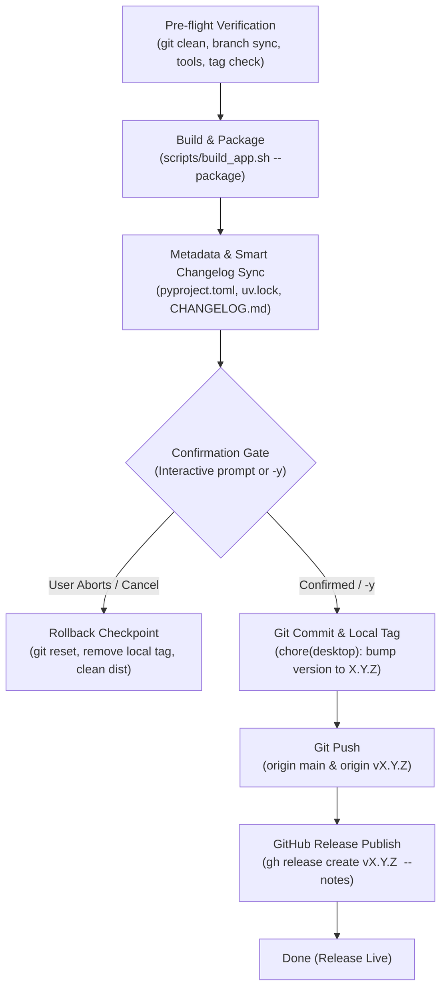

# Specification: Desktop Release Automation (Issue #13)

**Issue**: [#13](https://github.com/fabriziocacicia/rekordbox-collection-manager/issues/13)  
**Branch**: `build/desktop-release-automation`  
**Status**: SPECIFIED  

---

## Assumptions & Invariants

1. **Host Environment & Toolchain**:
   - macOS running on Apple Silicon (`arm64`).
   - GitHub CLI (`gh`) is installed, authenticated (`gh auth status`), and authorized to publish releases to `fabriziocacicia/rekordbox-collection-manager`.
   - Python dependency manager `uv`, C compiler `clang`, and macOS archiving tool `ditto` are present in `$PATH`.
2. **Git Context & State**:
   - Releases are cut from the `main` branch.
   - Working tree must be completely clean (`git status --porcelain` is empty).
   - Local `main` must be up to date with `origin/main` (`git fetch origin main && git rev-parse HEAD == git rev-parse origin/main`).
   - Target tag `v<version>` must not exist locally or on remote (`git ls-remote --tags origin refs/tags/v<version>`).
3. **Packaging Contract**:
   - Standalone application bundle and archive are built via `scripts/build_app.sh --package`.
   - Output archive is located at `dist/Rekordbox-Collection-Manager-v<version>-macOS-arm64.zip`.
4. **Changelog Standards**:
   - Adheres to Keep a Changelog 1.1.0 via `scripts/changelog.py`.
   - If `[Unreleased]` contains curated entries, it is rotated into `[<version>] - YYYY-MM-DD`.
   - If `[Unreleased]` is empty, desktop conventional commits since the previous tag are extracted, categorized, written into `CHANGELOG.md`, and rotated.
   - GitHub compare links at the bottom of `CHANGELOG.md` are updated.
5. **Safety & Zero-Drift Invariants**:
   - No remote state (git push or GitHub release) is modified if local building or packaging fails.
   - An initial git checkpoint (`git rev-parse HEAD`) is recorded. If local packaging fails or the user cancels at the prompt, all modified files (`pyproject.toml`, `uv.lock`, `CHANGELOG.md`) and any newly created local tag are rolled back to the checkpoint.
   - If network drops during `gh release create` post-push, existing git tags and zip archives remain intact, and idempotent resume instructions are printed.

---

## 1. Objective & Acceptance Criteria

Automate the full desktop release process into a single, transactional CLI command that eliminates manual release toil while maintaining strict safety gates.

### Acceptance Criteria
- [ ] `scripts/desktop_version.py <patch|minor|major|set <ver>> --release` runs the full 7-step pipeline end-to-end.
- [ ] `-y` / `--yes` flag allows non-interactive, unattended one-shot release execution.
- [ ] Interactive mode prompts for confirmation before remote push/publish, displaying a release preview.
- [ ] `--draft` creates the GitHub release in draft status instead of public.
- [ ] `--dry-run` previews version calculations, changelog changes, and GitHub release notes without modifying files, compiling, or executing network calls.
- [ ] If local build or packaging fails, zero remote git state (commits/tags) is created.
- [ ] Existing standalone flags (`--commit`, `--tag`, `--no-uv-lock`, `--no-changelog`, `--dry-run`) continue to operate without regression.
- [ ] Comprehensive unit and integration tests added in `tests/test_desktop_release.py`.

---

## 2. CLI Interface & Flag Definitions

```
scripts/desktop_version.py [action] [version] [flags]
```

### Positional Arguments
* `action`: One of `current`, `show`, `patch`, `minor`, `major`, `set`. When `--release` is passed, action must be one of `patch`, `minor`, `major`, or `set`.
* `version`: Explicit SemVer string required only when action is `set` (e.g. `scripts/desktop_version.py set 0.21.0 --release`).

### Release Flags
* `--release`: Orchestrates the complete 7-step automated release pipeline.
* `-y`, `--yes`: Non-interactive one-shot mode. Bypasses the confirmation prompt before git push and GitHub release publishing.
* `--draft`: Passes `--draft` to `gh release create`, staging the release on GitHub as a private draft.
* `--dry-run`: Runs the pipeline in preview mode. Validates pre-flight conditions, calculates the new version, displays the changelog diff and GitHub release notes preview, and exits with code 0 without disk or network mutations.

### Standard Flags (Preserved)
* `--commit`: Standalone version bump git commit (without full release pipeline).
* `--tag`: Standalone annotated git tag (without full release pipeline).
* `--no-uv-lock`: Skip synchronizing `uv.lock`.
* `--no-changelog`: Skip rotating `CHANGELOG.md`.

---

## 3. Seven-Step Safe Release Pipeline



### Step 1: Pre-Flight Verification
Validate preconditions before any disk mutation:
1. `git status --porcelain`: Fail if uncommitted changes or untracked files exist.
2. `git symbolic-ref --short HEAD`: Ensure current branch is `main`.
3. `git fetch origin main`: Check `git rev-parse HEAD == git rev-parse origin/main`. Fail if local branch is ahead/behind.
4. `git ls-remote --tags origin refs/tags/v<new_version>`: Fail if remote tag already exists.
5. `git tag -l v<new_version>`: Fail if local tag already exists.
6. Check required tools:
   - `shutil.which("uv")`
   - `shutil.which("clang")`
   - `shutil.which("ditto")`
   - `shutil.which("gh")` and `gh auth status` exits with 0.

### Step 2: Binary Build & Packaging
1. Record checkpoint git commit: `checkpoint_sha = run_git(["rev-parse", "HEAD"])`.
2. Clean old conflicting packaging intermediates in `dist/`.
3. Execute `scripts/build_app.sh --package` with version environment or current updated target.
4. Verify expected archive exists: `dist/Rekordbox-Collection-Manager-v<new_version>-macOS-arm64.zip`.
5. Capture archive size and SHA256 checksum.

### Step 3: Metadata & Smart Changelog Sync
1. Update `version = "<new_version>"` in `pyproject.toml`.
2. Run `uv lock` to synchronize `uv.lock`.
3. Synchronize `CHANGELOG.md`:
   - Inspect `## [Unreleased]` section.
   - If `[Unreleased]` has entries: rotate into `## [<new_version>] - YYYY-MM-DD`.
   - If `[Unreleased]` has no entries: invoke commit extractor from `scripts/changelog.py` for desktop commits since last `v*` tag, categorize entries, populate section, and rotate.
   - Update bottom compare links: `[Unreleased]: .../v<new_version>...HEAD` and `[<new_version>]: .../v<prev>...v<new_version>`.
4. Extract the exact rotated markdown text of `## [<new_version>]` to serve as the GitHub Release body.

### Step 4: Confirmation Gate
1. Format release summary:
   - Target Version: `<new_version>`
   - Standalone Archive: `dist/Rekordbox-Collection-Manager-v<new_version>-macOS-arm64.zip` (Size)
   - Changelog Diff & Release Body Preview
2. If `--dry-run`: display preview and exit 0.
3. If not `-y` / `--yes` and running in a TTY:
   - Prompt `Proceed with git push and GitHub release publish? [Y/n]: `
   - If user denies, trigger local rollback to `checkpoint_sha` and exit.

### Step 5: Git Commit & Tagging
1. Stage modified files: `git add pyproject.toml uv.lock CHANGELOG.md`.
2. Commit: `git commit -m "chore(desktop): bump version to <new_version>"`.
3. Create annotated tag: `git tag -a v<new_version> -m "Rekordbox Collection Manager v<new_version>"`.

### Step 6: Git Push
1. Push branch: `git push origin main`.
2. Push tag: `git push origin v<new_version>`.

### Step 7: Publish GitHub Release
1. Write release notes body to a temporary or staging file `dist/RELEASE_NOTES_<new_version>.md`.
2. Execute:
   ```bash
   gh release create v<new_version> \
       dist/Rekordbox-Collection-Manager-v<new_version>-macOS-arm64.zip \
       --title "Rekordbox Collection Manager v<new_version>" \
       --notes-file dist/RELEASE_NOTES_<new_version>.md \
       [--draft]
   ```
3. Report success with release URL.

---

## 4. Failure Recovery & Rollback Strategy

| Stage of Failure | System State | Automated Action | Manual Recovery Instructions |
| :--- | :--- | :--- | :--- |
| **Pre-flight Check** | No files or git state touched. | Exit immediately with code 1. | Fix reported issue (e.g. commit files, authenticate `gh`). |
| **Build / Packaging Failure** | `dist/` may have partial build. | Clean partial build; files remain untouched. | Fix build error and re-run. |
| **Metadata Update Failure** | `pyproject.toml` or `uv.lock` altered. | Revert modified files to checkpoint via `git checkout -- .`. | Re-run command. |
| **User Abort at Confirmation** | Files altered, binary built. | Revert modified files to checkpoint via `git checkout -- .`. Delete local tag if created. | Working tree returns to 100% clean. |
| **Push Failure (Branch or Tag)** | Local commit & tag created; remote untouched. | Keep local commit & tag. Output commands to push or reset. | Push manually: `git push origin main && git push origin v<new_version>`, or reset: `git reset --hard HEAD~1 && git tag -d v<new_version>`. |
| **GitHub Release Upload Failure** | Remote branch & tag pushed; release missing on GitHub. | Tag and `.zip` archive preserved; no destructive remote git commands run. | Print resume command: `gh release create v<new_version> <zip_path> --title "..." --notes-file "..."`. Re-running `--release` detects existing tag and resumes upload. |

---

## 5. Testing & Verification Plan

### Unit & Integration Tests (`tests/test_desktop_release.py`)
1. **Pre-flight Tests**:
   - Verify detection of dirty git working tree.
   - Verify detection of detached HEAD or non-main branch.
   - Verify detection of remote tag collision.
   - Verify missing CLI dependency diagnostics (`gh`, `uv`, `clang`, `ditto`).
2. **Version Bump & Rollback Tests**:
   - Mock build failure $\to$ verify `pyproject.toml`, `uv.lock`, and `CHANGELOG.md` are restored to checkpoint.
   - Verify interactive cancellation (`n`) cleanly resets local modifications and deletes local tag.
3. **Smart Changelog Sync Tests**:
   - Verify populated `[Unreleased]` rotation.
   - Verify unpopulated `[Unreleased]` triggers auto-extraction of desktop commits and ignores iOS commits.
   - Verify compare link generation for the new release tag.
4. **Dry-Run Tests**:
   - Verify `--dry-run` displays version, changelog diff, and release preview without writing files or calling subprocesses.
5. **CLI Argument Parser Tests**:
   - Verify `--release` requires an action (`patch`, `minor`, `major`, `set`).
   - Verify `-y`, `--draft`, and `--dry-run` flag handling.

---

## 6. Proactive Zero-Drift Documentation Updates

In accordance with project rules, all documentation referencing desktop release commands must be updated:
1. `scripts/README.md`: Document `--release`, `-y`, `--draft`, and `--dry-run` flags and usage examples.
2. `AGENTS.md`: Update "Essential Commands" under "Operational & Release Scripts" with `--release` command.
3. `README.md`: Document desktop release publishing workflow in Developer Guide.
