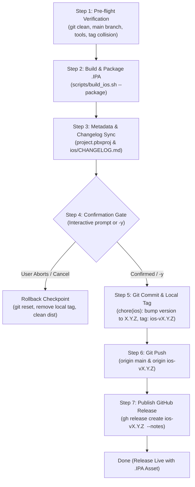

# Specification: iOS Companion Release Automation & SideStore Packaging (Issue #29)

**Issue**: [#29](https://github.com/fabriziocacicia/rekordbox-collection-manager/issues/29)  
**Branch**: `build/ios-release-automation`  
**Status**: APPROVED  

---

## Assumptions & Invariants

1. **Host Environment & Toolchain**:
   - macOS running on Apple Silicon (`arm64`) or Intel with Xcode Command Line Tools (`xcodebuild`).
   - GitHub CLI (`gh`) is installed, authenticated (`gh auth status`), and authorized to publish releases to `fabriziocacicia/rekordbox-collection-manager`.
   - Built-in macOS archiving utility `ditto` and Python 3.11+ (via `uv` or system Python) are available in `$PATH`.
2. **Git Context & State**:
   - Releases are cut strictly from the `main` branch.
   - Working tree must be completely clean (`git status --porcelain` is empty).
   - Local `main` must be up to date with `origin/main` (`git fetch origin main && git rev-parse HEAD == git rev-parse origin/main`).
   - Target tag `ios-v<version>` must not exist locally or on remote (`git ls-remote --tags origin refs/tags/ios-v<version>`).
3. **Packaging Contract**:
   - iOS companion app bundle and archive are built via `scripts/build_ios.sh [--package]`.
   - Output archive is located at `dist/RekordboxCompanion-v<version>.ipa` (or `dist/RekordboxCompanion-ios-v<version>.ipa`).
   - The `.ipa` is packaged as a standard iOS application payload (`Payload/RekordboxCompanion.app`), built with ad-hoc/local signing (`CODE_SIGN_IDENTITY="-"` or unsigned `CODE_SIGNING_ALLOWED=NO`), designed for on-device re-signing by SideStore / AltStore / personal free Apple ID.
4. **Changelog & Versioning Separation**:
   - iOS versioning is completely decoupled from Desktop versioning (`v<version>` vs `ios-v<version>`).
   - iOS versions are stored in `ios/RekordboxCompanion/RekordboxCompanion.xcodeproj/project.pbxproj` (`MARKETING_VERSION` and `CURRENT_PROJECT_VERSION`).
   - Dedicated `ios/CHANGELOG.md` tracks iOS companion changes adhering to Keep a Changelog 1.1.0, preventing version collision or noise with desktop `CHANGELOG.md`.
5. **Safety & Zero-Drift Invariants**:
   - No remote state (git push or GitHub release) is modified if local building or packaging fails.
   - An initial git checkpoint (`git rev-parse HEAD`) is recorded. If local packaging fails or the user cancels at the confirmation prompt, all modified files and local tags are rolled back to the checkpoint.
   - If network drops during `gh release create` post-push, existing git tags and `.ipa` archives remain intact, and idempotent resume instructions are printed.

---

## 1. Objective & Acceptance Criteria

Automate the full iOS companion app release process into a single, transactional CLI command that builds a ready-to-sideload `.ipa`, updates Xcode project metadata, rotates the changelog, tags the release, and publishes a GitHub Release with the attached `.ipa` asset.

### Acceptance Criteria
- [ ] `scripts/build_ios.sh [--clean] [--package]` builds the SwiftUI target using `xcodebuild archive` and packages `dist/RekordboxCompanion-v<version>.ipa`.
- [ ] `scripts/ios_version.py <patch|minor|major|set <ver>> --release` orchestrates the complete 7-step safe release pipeline end-to-end.
- [ ] `-y` / `--yes` flag allows non-interactive, unattended one-shot release execution.
- [ ] `--draft` creates the GitHub release in draft status on GitHub.
- [ ] `--dry-run` previews version calculations, changelog changes, and GitHub release notes without writing files or making network calls.
- [ ] Dedicated `ios/CHANGELOG.md` created and maintained following Keep a Changelog 1.1.0 standard for iOS companion commits.
- [ ] Clear setup and update guide for SideStore added to `ios/RekordboxCompanion/README.md`.
- [ ] Comprehensive unit tests added in `tests/test_ios_release.py`.

---

## 2. CLI Interface & Flag Definitions

### `scripts/build_ios.sh`
```bash
./scripts/build_ios.sh [--package] [--clean] [--output <dir>]
```
- `--package`: Generates the final `.ipa` file inside `dist/` (defaults to building `.app` in build directory if omitted).
- `--clean`: Purges previous build intermediates (`build/ios/` and `dist/RekordboxCompanion*.ipa`).
- `--output <dir>`: Custom destination for the output `.ipa` (defaults to `dist/`).

### `scripts/ios_version.py`
```bash
python scripts/ios_version.py [action] [version] [flags]
```

#### Positional Arguments
- `action`: One of `show`, `current`, `patch`, `minor`, `major`, `set`. When `--release` is passed, action must be `patch`, `minor`, `major`, or `set`.
- `version`: Explicit SemVer string required only when action is `set` (e.g. `python scripts/ios_version.py set 0.2.0 --release`).

#### Release Flags
- `--release`: Orchestrates the 7-step automated release pipeline.
- `-y`, `--yes`: Non-interactive one-shot mode; skips the confirmation prompt before git push and GitHub release publishing.
- `--draft`: Passes `--draft` to `gh release create`, staging the release as a private draft.
- `--dry-run`: Previews the version calculation, changelog diff, and GitHub release notes without mutating files, compiling, or executing network calls.

#### Existing Standalone Flags (Preserved)
- `--commit`: Standalone version bump git commit in `project.pbxproj`.
- `--tag`: Standalone annotated git tag (`ios-v<version>`).
- `--dry-run`: Previews pbxproj modifications.

---

## 3. Seven-Step Safe Release Pipeline



### Step 1: Pre-Flight Verification
Validate preconditions before touching disk or git:
1. `git status --porcelain`: Fail if uncommitted changes or untracked files exist.
2. `git symbolic-ref --short HEAD`: Ensure current branch is `main`.
3. `git fetch origin main`: Ensure `git rev-parse HEAD == git rev-parse origin/main`. Fail if local branch is ahead/behind.
4. `git ls-remote --tags origin refs/tags/ios-v<new_version>`: Fail if remote tag already exists.
5. `git tag -l ios-v<new_version>`: Fail if local tag already exists.
6. Check required tools:
   - `shutil.which("xcodebuild")`
   - `shutil.which("ditto")`
   - `shutil.which("gh")` and `gh auth status` exits with 0.

### Step 2: Build & Package .IPA
1. Record git checkpoint commit: `checkpoint_sha = run_git(["rev-parse", "HEAD"])`.
2. Clean old intermediates in `dist/RekordboxCompanion*.ipa`.
3. Execute `scripts/build_ios.sh --package`.
4. Verify expected archive exists: `dist/RekordboxCompanion-v<new_version>.ipa`.
5. Capture archive size and SHA256 checksum.

### Step 3: Metadata & Changelog Sync
1. Bump `MARKETING_VERSION` to `<new_version>` and increment `CURRENT_PROJECT_VERSION` by +1 in `project.pbxproj`.
2. Synchronize `ios/CHANGELOG.md`:
   - Inspect `## [Unreleased]` section in `ios/CHANGELOG.md`.
   - If `[Unreleased]` has entries: rotate into `## [<new_version>] - YYYY-MM-DD`.
   - If `[Unreleased]` is empty: extract commits touching `ios/` or scoped `ios` since previous `ios-v*` tag, categorize entries, and rotate.
   - Update compare links at the bottom: `[Unreleased]: .../compare/ios-v<new>...HEAD` and `[<new>]: .../compare/ios-v<prev>...ios-v<new>`.
3. Extract rotated release body markdown to serve as the GitHub Release notes.

### Step 4: Confirmation Gate
1. Display release summary:
   - Target Version: `<new_version>` (Build: `<new_build>`)
   - Standalone Asset: `dist/RekordboxCompanion-v<new_version>.ipa` (Size, SHA256)
   - Changelog Diff & GitHub Release Notes preview
2. If `--dry-run`: display preview and exit 0.
3. If interactive (TTY) and not `-y` / `--yes`:
   - Prompt: `Proceed with git push and GitHub release publish? [Y/n]: `
   - If user denies, roll back to `checkpoint_sha` and exit.

### Step 5: Git Commit & Tagging
1. Stage modified files: `git add ios/RekordboxCompanion/RekordboxCompanion.xcodeproj/project.pbxproj ios/CHANGELOG.md`.
2. Commit: `git commit -m "chore(ios): bump version to <new_version> (build <new_build>)"`.
3. Create annotated tag: `git tag -a ios-v<new_version> -m "Rekordbox Companion iOS v<new_version>"`.

### Step 6: Git Push
1. Push branch: `git push origin main`.
2. Push tag: `git push origin ios-v<new_version>`.

### Step 7: Publish GitHub Release
1. Write release notes body to `dist/RELEASE_NOTES_ios_<new_version>.md`.
2. Execute:
   ```bash
   gh release create ios-v<new_version> \
       dist/RekordboxCompanion-v<new_version>.ipa \
       --title "Rekordbox Companion iOS v<new_version>" \
       --notes-file dist/RELEASE_NOTES_ios_<new_version>.md \
       [--draft]
   ```
3. Report success with release URL.

---

## 4. Packaging Contract (`scripts/build_ios.sh`)

1. **Build Invocation**:
   ```bash
   xcodebuild archive \
     -project ios/RekordboxCompanion/RekordboxCompanion.xcodeproj \
     -scheme RekordboxCompanion \
     -configuration Release \
     -destination 'generic/platform=iOS' \
     -archivePath build/ios/RekordboxCompanion.xcarchive \
     CODE_SIGN_IDENTITY="-" \
     CODE_SIGNING_ALLOWED=YES
   ```
2. **Payload Packaging**:
   ```bash
   mkdir -p build/ios/Payload
   cp -R build/ios/RekordboxCompanion.xcarchive/Products/Applications/RekordboxCompanion.app build/ios/Payload/
   ditto -c -k --keepParent build/ios/Payload dist/RekordboxCompanion-v${VERSION}.ipa
   rm -rf build/ios/Payload
   ```
3. **Artifact Integrity**:
   Verify `dist/RekordboxCompanion-v${VERSION}.ipa` is non-empty and contains `Payload/RekordboxCompanion.app/Info.plist`.

---

## 5. SideStore Setup & Onboarding Contract

Add a dedicated **"Sideloading & Permanent Installation via SideStore"** section in `ios/RekordboxCompanion/README.md`:
1. **Initial Setup (One-time)**:
   - Install SideStore on iPhone via SideServer / AltServer with a free Apple ID.
   - Pair device and save pairing file (`.mobiledevicepairing`).
   - Enable local WireGuard VPN loopback profile in SideStore.
2. **Installation**:
   - Download `RekordboxCompanion-v<version>.ipa` from the GitHub Releases tab directly in Safari on iPhone.
   - Tap Share $\to$ "Open in SideStore". SideStore signs the app with your free Apple ID and installs it.
3. **Overnight Auto-Refresh (Hands-off)**:
   - Configure an iOS Shortcut: *Daily at 2:00 AM $\to$ SideStore "Refresh Apps"*.
   - Because you connect to Wi-Fi daily, the 7-day expiration timer resets automatically every night without requiring a Mac.

---

## 6. Failure Recovery & Rollback Strategy

| Failure Point | System State | Automated Action | Manual Recovery Instructions |
|:---|:---|:---|:---|
| **Pre-flight Check** | No files or git state touched. | Exit immediately with code 1. | Fix reported issue (commit changes, authenticate `gh`, etc.). |
| **IPA Build / Packaging** | Partial archive in `build/ios/` or `dist/`. | Clean partial build; files remain untouched. | Fix compilation/archive error and re-run. |
| **Metadata Update Failure** | `project.pbxproj` or `ios/CHANGELOG.md` altered. | Revert modified files to checkpoint via `git checkout -- .`. | Re-run command. |
| **User Abort at Confirmation** | Files altered, `.ipa` built. | Revert modified files to checkpoint via `git checkout -- .`. Delete local tag if created. | Working tree returns to clean checkpoint. |
| **Push Failure (Branch/Tag)** | Local commit & tag created; remote untouched. | Keep local commit & tag. Output push/reset commands. | Push manually: `git push origin main && git push origin ios-v<version>`, or reset: `git reset --hard HEAD~1 && git tag -d ios-v<version>`. |
| **GitHub Release Upload Failure** | Remote branch & tag pushed; release missing. | Tag and `.ipa` preserved; no destructive commands. | Print resume command: `gh release create ios-v<version> dist/...ipa --title "..." --notes-file "..."`. |

---

## 7. Testing & Verification Plan

### Test Suite (`tests/test_ios_release.py`)
1. **Pre-flight Checks**:
   - Verify detection of dirty git working tree.
   - Verify non-main branch detection.
   - Verify tag collision detection (`ios-v<version>`).
   - Verify missing tool diagnostics (`xcodebuild`, `ditto`, `gh`).
2. **Version Bump & Rollback**:
   - Verify `project.pbxproj` `MARKETING_VERSION` and `CURRENT_PROJECT_VERSION` updates.
   - Verify mock build failure triggers rollback to checkpoint.
   - Verify user cancellation (`n`) cleanly resets files.
3. **Changelog Extraction & Rotation**:
   - Verify extraction of `ios/` and `feat(ios)` commits for `ios/CHANGELOG.md`.
   - Verify desktop commits are excluded from `ios/CHANGELOG.md`.
   - Verify compare link generation for `ios-v<version>`.
4. **Dry-Run Mode**:
   - Verify `--dry-run` displays preview without modifying files or executing network calls.
5. **Build Script Verification**:
   - Verify `./scripts/build_ios.sh --help` and clean options.

---

## 8. Out of Scope (Deferred)

- **Apple Developer Program Automated App Store / TestFlight Upload**: Deferred to when/if a paid Apple Developer team is enrolled.
- **Automated GitHub Actions CI Sideload Builder**: Deferred until self-hosted or macOS runners with Xcode are configured in repo CI.
- **PWA Implementation**: Explicitly rejected in Issue #8 in favor of native SwiftUI + SideStore.

---

## 9. Resolved Design Decisions

1. **Tag Naming**: Confirmed as `ios-v<version>` (e.g. `ios-v0.1.2`), maintaining consistency with `scripts/ios_version.py`.
2. **Changelog Location**: Confirmed as `ios/CHANGELOG.md`, completely decoupling iOS companion releases from desktop releases.
